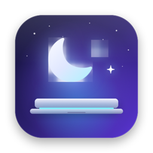
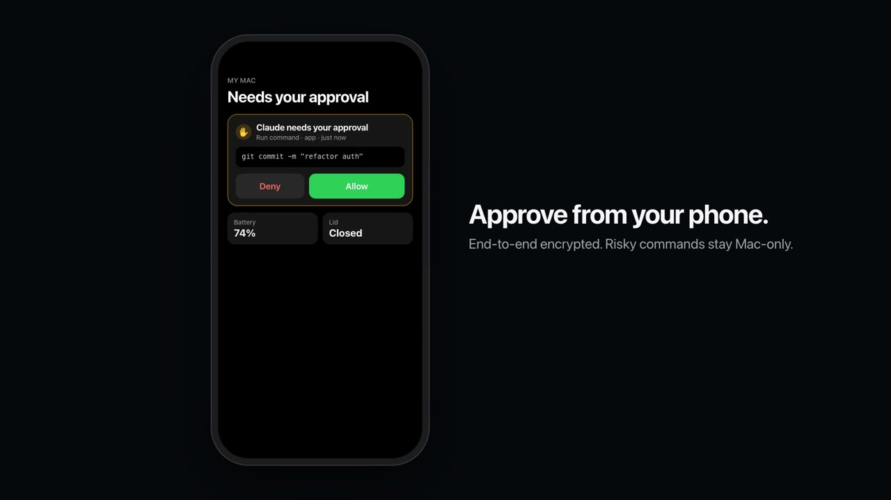
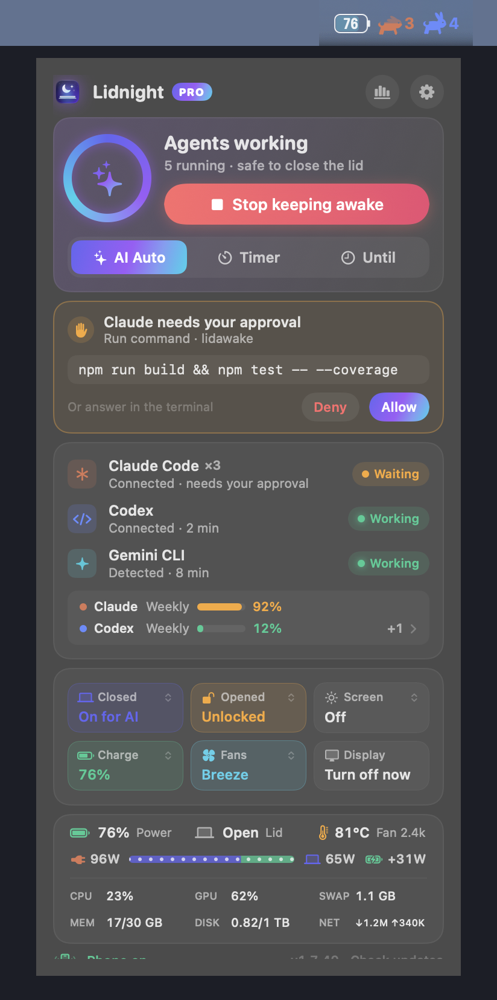

<p align="center"></p>

<h1 align="center">Lidnight</h1>
<p align="center"><b>Keep your MacBook awake with the lid closed while AI agents work — then let it sleep.</b><br>
Claude Code · Codex · Gemini CLI · Ollama · LM Studio and 40+ more · Apple Silicon · macOS 13+</p>

<p align="center">
<a href="https://lidnight.app/en/"><b>Website</b></a> ·
<a href="https://lidnight.app/download/Lidnight.dmg">Download (free)</a> ·
<a href="https://lidnight.app/en/security/">Security</a> ·
<a href="https://lidnight.app/en/guides/">Guides</a> ·
<a href="https://github.com/whereisdw/lidnight-mac/issues">Issues</a>
</p>

<p align="center"><a href="https://lidnight.app/en/"></a></p>

```bash
brew install whereisdw/tap/lidnight
```

Using Claude Code? The [Lidnight plugin](https://github.com/whereisdw/lidnight-claude-plugin) adds `/lidnight:awake`, `/lidnight:status` and `/lidnight:sleep`:

```text
/plugin marketplace add whereisdw/lidnight-claude-plugin
/plugin install lidnight@lidnight
```

## Why

Close a MacBook with no external display and macOS sleeps — and your Claude Code / Codex run stalls a few minutes in. `caffeinate` only blocks *idle* sleep, and `sudo pmset -a disablesleep 1` works but stays on until you remember to undo it (heat, drained battery, a hot bag).

Lidnight turns lid-closed sleep prevention **on while agents are actually working, and off when they're done**.

## What it does

- **Lid closed, even on battery** — through a small helper that only runs a fixed list of power commands. A watchdog restores sleep settings if the app quits; after a power loss they're restored at the next boot.
- **Knows when the work is done** — Claude Code and Codex precisely via their hooks; 40+ other tools (Gemini CLI, Aider, Kiro CLI, Ollama, LM Studio…) from process and GPU activity. Sleeps 10 minutes after everything goes quiet.
- **Continue after a limit reset** — when Claude Code or Codex stops on a 5-hour or weekly limit, choose per agent whether it picks the task back up after the reset. Claude Code continues on its own after a 5-hour reset and Lidnight keeps the Mac awake until then; when an agent wouldn't continue on its own (weekly limit, long sleep), Lidnight sends a one-line "please continue" via Claude Code's official session messaging or `codex queue`.
- **Approve from anywhere** — answer Claude Code permission prompts from a Mac notification, the menu bar, a bunny next to the notch, or your phone (end-to-end encrypted; `rm -rf` / `git push` / `sudo` stay Mac-only).
- **Heads-ups that save a run** — a ping the moment Codex asks you a question (it may go ahead with its suggested answer if you don't reply), a warning when a usage limit drains fast enough to run out before the reset, and a nudge when finished Claude Code sessions leave processes eating memory (Clean up ends only those).
- **Safety** — alert at 42 °C, sleep at 45 °C or at a battery floor you set.
- **Limits & usage** — Claude/Codex 5-hour and weekly limits, tokens and estimated cost, a bunny per agent in the menu bar.

<p align="center"></p>

## Pricing

Free with the lid open: AI Auto mode, battery & heat protection, approvals on the Mac.
Pro (one-time, no subscription) is required with the lid closed (on battery or plugged in), and adds auto-start, phone approvals and more. Every download includes a 7-day Pro trial, no payment details needed. 14-day refund.

Launch pricing through Oct 31: $4.99 (1 Mac) / $7.50 (3 Macs).
Regular pricing from Nov 1 is shown on https://lidnight.app/en/#pricing

## Privacy

No account. Your code and conversations never leave the Mac. The app sends only five anonymous daily counts (like "purchase screen opened", no device or ID), and you can turn that off in Settings. Phone status is encrypted on the Mac (AES-GCM) and commands are one-time HMAC signatures — the relay can't read them. Details: https://lidnight.app/en/security/

## Support

Bug reports and feature requests: [open an issue](https://github.com/whereisdw/lidnight-mac/issues) or email support@dawonlabs.com.
This repository hosts the README and issue tracker; Lidnight itself is a closed-source, notarized app from Dawon Labs.
